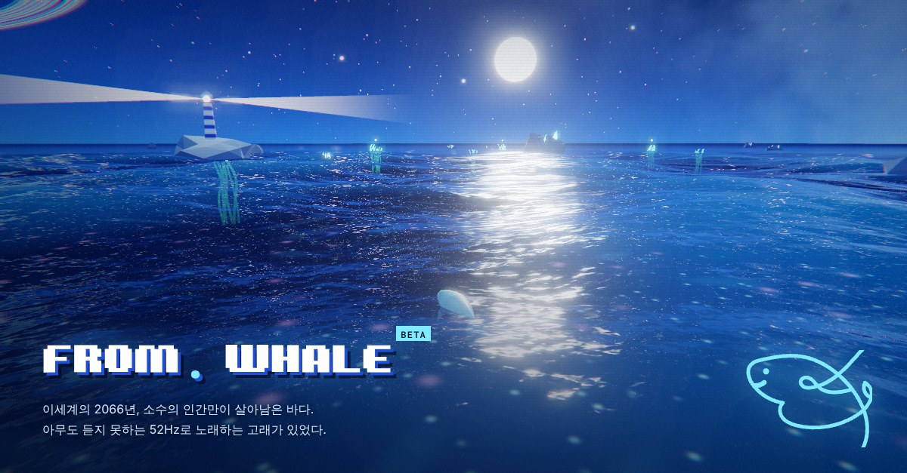
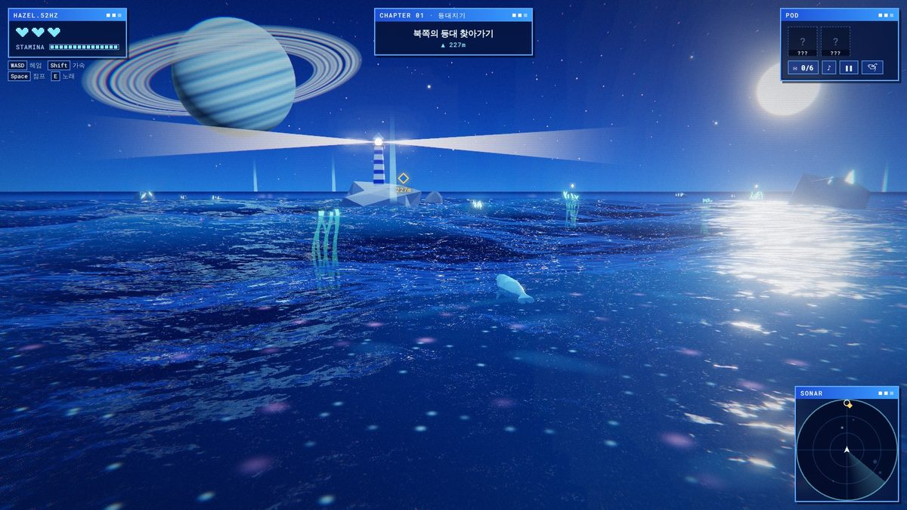
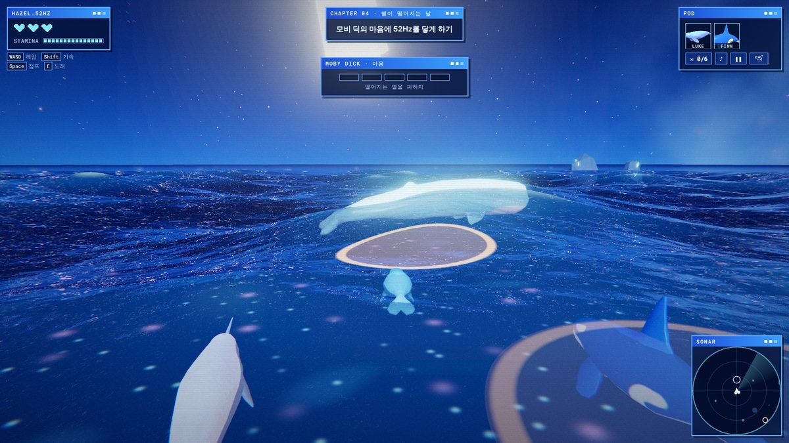
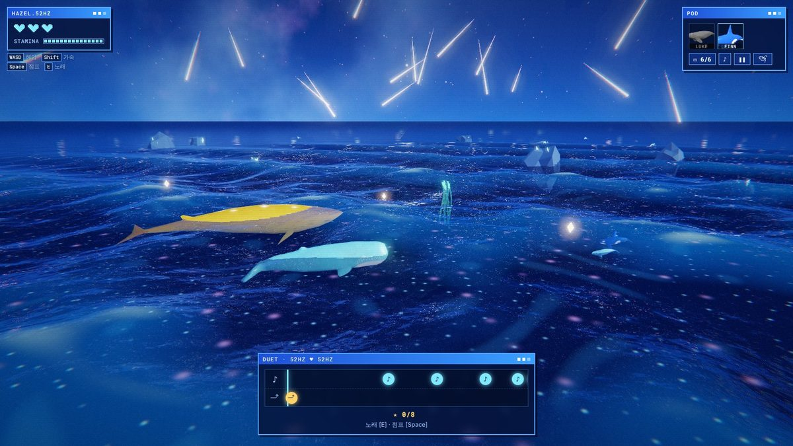
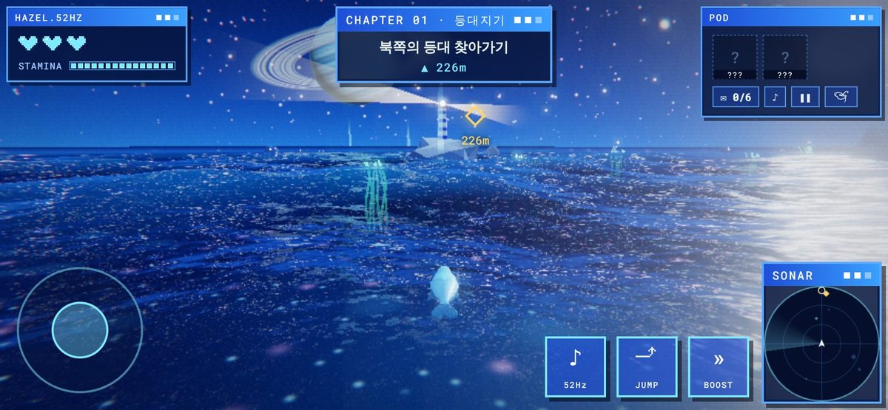

# 🐋 From. Whale

[English](README.md) · **한국어**

**[▶ 바로 플레이](https://from-whale.netlify.app/game/)** · [첫 화면](https://from-whale.netlify.app/) · 설치 없이 브라우저에서 (PC · 폰)

52Hz로 노래하는 고래 **헤이즐**의 바다 모험 게임. 이세계의 2066년, 밤바다. (BETA)

- MAP 1 · **별이 떨어지는 밤** — 밤바다: 등대, 미역, 연합군, 모비 딕, 스텔라
- MAP 2 · **파도 없이 태어난 바다** — 해구를 따라 연합군이 태어난 기지까지

| 등대와 고리 행성 | 모비 딕 보스전 |
| --- | --- |
|  |  |
| **스텔라와 듀엣 · 별똥별** | **폰 가로 화면** |
|  |  |

- 로컬 실행: 저장소 루트에서 `python3 -m http.server` → <http://localhost:8000/game/> (듀엣 점수판은 이 기기 기록만. 서버까지는 `npx netlify dev`)
- 언어: 한국어 · English · 日本語 (기기 언어 자동 선택)
- 닉네임 설정 (기본: 헤이즐 / Hazel / ヘイゼル)
- 저장: 챕터 단위 이어하기, 본 엔딩은 따로 기록
- 실험실 (폰 일시정지 메뉴): 기울기 조종, 가로 모드 전용. 프롤로그에서 안내
- 의견 보내기: 엔딩 화면 → Netlify Forms `feedback` (폼 감지 · 메일 알림 설정 필요)
- 링크 공유 미리보기: `data/res/og.jpg` (1200×627, 첫 장면 달빛 캡처). 바꾼 뒤 LinkedIn Post Inspector로 새로고침

### 특징

- **싸우지 않는 게임** — 공격 없이 52Hz 노래만. 보스 모비 딕도 노래로 설득
- **52Hz = 게임 규칙** — 아무도 못 알아듣는 노래, 루크의 편지 통역
- **따라 부르기** — 핀의 울음 박자에 노래로 대답 (2장)
- **자라는 음악** — 실시간 합성. 루크 베이스, 핀 드럼, 동료가 떠나면 빠짐. 에필로그 색소폰
- **엔딩 6개 + 엔딩 도감** — 루크 · 핀의 운명으로 갈리는 4개 + 지각한 고래 + 멈춘 고래의 심장 (아래). 못 본 엔딩은 힌트만. 6개를 다 모으면 보상으로 **금빛 바다** (윤슬이 금빛 → 하늘색으로 번짐, 금빛 달, 헤이즐의 빛 문양이 더 반짝임)
- **미역 줄기** — 길 안내 글, 곁에서 노래하면 하트 회복
- **모비 딕 보스전** — 노래 6번이 닿으면 설득. 몸 충돌 · 떨어지는 별에 하트 −1, 기절은 별 1.1초 · 돌진 1.5초 (핀의 눈물이 있으면 노래로 바로 풀기)
- **스텔라 (숨겨진 엔딩)** — 유리병 편지 6통 (프롤로그의 모비 편지 포함) → 12마디 블루스 듀엣 (PERFECT ±25ms · EXCELLENT ±60ms · GOOD ±150ms 판정, 450점 만점, S 85% · A 60% 이상, 점프 노트마다 별똥별) → 노래 이름을 지어 닉네임 · 점수와 함께 모두가 보는 **듀엣 TOP 10**에 기록. 스텔라를 만난 뒤엔 타이틀 · 엔딩 화면의 '듀엣 다시 부르기'로 듀엣만 반복 (이어하기 저장은 그대로). 엔딩 후 에필로그에서 남은 편지 수집
- **우주와 바다** — Gerstner 파도, 윤슬, 고리 행성, 별똥별, 블룸
- **MAP 2 · 파도 없이 태어난 바다 (BETA)** — 스텔라를 만난 뒤 열리는 두 번째 맵. 해구를 따라 내려가며 연합군의 비밀을 밝힘 (아래 MAP 2)
- **레트로 파란 UI** — 창 모양 HUD, 소나 미니맵 (제목 줄을 누르면 접기, 기기에 기억), 챕터 카드, PC 조작 안내, 목표는 HAZEL 창 아래 칸 (화면 위 가운데 비움). 폰 세로 모드는 아래 한 줄에 조이스틱 · 소나 · 버튼 2×2 (오른손 엄지 자리, 화면 가운데 비움). 폰 가로 모드 대화창은 아래쪽 한 줄, 타이틀은 두 칸, 기울기 모드의 따라 부르기 창은 왼쪽 아래
- **가벼운 모델** — 고래당 정점 500~650개, 512px 텍스처. 폰 지원

### 갈래 엔딩

- 루크: 모비 딕 앞에 닿을 때까지 연합군에게 두 번 맞지 않으면 생존 (처음 맞으면 루크의 경고), 루크의 등불 (보스전 노래 범위 확대). 매복 전에 두 번 맞았으면 3장 매복에서, 매복을 함께 넘긴 뒤 두 번째로 맞으면 그 자리에서 루크가 대신 들이받고 희생 → 빛 조각 (가속)
- 보스전: 처음 쓰러지면 핀이 대신 맞음 → 부서진 나침반 (길 안내가 흐려지다 꺼짐, 미역 곁 노래로 복구) + 핀의 눈물 (기절 중 노래하면 보랏빛 비, 기절 즉시 해제)
- 모비 딕을 만나기 전에 편지 6통을 다 모으면: **지각한 고래** 엔딩 (루크 · 핀과 무관, 모비의 핀잔, 스텔라도 지각) → 스텔라 듀엣까지 한 판에 엔딩 2개
- 한 장에서 두 번 쓰러지면: **멈춘 고래의 심장** 엔딩 → 이어하기로 그 장 처음부터 (핀이 대신 맞은 건 세지 않음)

| 엔딩 | 루크 | 핀 |
| --- | --- | --- |
| 꺼지지 않는 빛 | ✕ | ○ |
| 동료의 힘 | ○ | ○ |
| 부서진 나침반 | ○ | ✕ |
| 희생 | ✕ | ✕ |
| 지각한 고래 | 무관 | 무관 |

### MAP 2 · 파도 없이 태어난 바다 (BETA)

이름의 뜻: 파도가 닿지 않는 깊은 바다, 그리고 기지의 수조에서 파도를 모른 채 태어난 연합군 (그리고 핀).

- 가는 길: 스텔라를 만난 뒤 엔딩 화면의 '바닷속으로' → 수면의 포털 → 잠수. 맵 1(등대, 미역, 연합군 등)은 모두 사라짐
- 진행: 협곡을 따라 계속 아래로. 층마다 연구 일지 하나, 읽기 전엔 물살이 아래를 막음. 루크가 있으면 글자 통역, 없으면 그림만
- 어둠: 깊을수록 달빛이 사라짐. 헤이즐 등의 빛과 노래(소나)가 조명. 위로는 물결치는 수면과 빛 그물
- 이야기: 연합군은 인간의 AI 실험. 샤먼은 기지 AI의 명령을 '심연의 목소리'로 믿음, 고래 뼈는 '정화' 제단
- 경비 연합군: 협곡 가운데를 순찰. 들키면 1초 노려본 뒤 추격, 그 사이 벽으로 피하면 안 쫓음. 벽의 곰치 굴은 금기
- 노래: 근처 곰치가 붉게 드러남 (소나에 빨간 점). 가까운 경비는 스텔라에게 배운 '완벽한 노래'에 3.5초 멈춤, 멀리서 들은 경비는 몰려옴
- 곰치: 벽 틈에 숨어 있다가 몸을 떨고 튀어나와 물기 (하트 1개, 짧은 기절)
- 하트: 일지를 읽으면 회복, 해파리에 닿으면 1개 (그 해파리는 30초 충전). 쓰러지면 마지막으로 읽은 일지 앞에서 깨어남 (심장 멈춤 엔딩 없음)
- 끝: 기지 문 앞의 샤먼 → 정지 코드 리듬 (스텔라의 목소리 + 핀의 장치, 핀이 없으면 부서진 나침반) → 붉은 눈이 꺼지고 샤먼의 목소리도 멈춤 → MAP 2 엔딩 '들리는 노래'

| 층 | 깊이 | 연구 일지 | 바다 생물 · 위험 |
| --- | --- | --- | --- |
| 햇빛층 | 0~40m | 부서진 잠수정 (30m) | 열대어 떼 (다가가면 흩어짐) |
| 어스름층 | 40~120m | 해저 연구소 (80m) | 가오리, 그루퍼, 바라쿠다, 암초상어 · 경비, 곰치 |
| 한밤층 | 120~250m | 붉은 단말기 (150m), 고래 뼈 제단 (205m) | 빛나는 보름달물해파리 (노래하면 더 환하게) · 경비, 곰치 |
| 해구 | 250~318m | 대학원생 J의 마지막 기록 (270m), 돌 낚싯바늘 | 실러캔스 · 경비, 곰치 |
| 기지 | 318m~ | 박사의 메모 (312m) | 게, 성게, 불가사리, 새우 · 샤먼 |

### 등장인물

| 이름 | 설정 | 모델 |
| --- | --- | --- |
| 헤이즐 | 52Hz 상괭이, 등의 빛 문양 | `data/hazel/Hazel.glb` |
| 루크 | 일각고래 등대지기, 통역사 | `data/luke/Luke.glb` |
| 핀 | 울보 범고래 길잡이 | `data/finn/Finn.glb` |
| 연합군 | 범고래 무리, MAP 2에선 해구의 경비 | `data/orca_army/Orca_Army.glb` |
| 연합군 대장 · 샤먼 | 분홍 범고래, 기지 AI를 '심연의 목소리'로 믿음 (MAP 2) | `Orca_Army.glb` + `recolor` |
| 모비 딕 | 향유고래, 마지막 보스 | `data/moby/Moby.glb` |
| 스텔라 | 노란 대왕고래, 또 하나의 52Hz, 목주름, 등의 반짝이는 육각별 문양 | `data/stella/Stella.glb` (코드로 생성: `tools/make_stella.py`) |
| MAP 2 바다 생물 | 열대어, 해파리, 실러캔스, 게 등 (24종), 위협은 곰치 | `data/polyfork/*.glb` ([Polyfork](https://polyfork.dev) 무료 로우폴리, Meshopt 압축, 포털이 열릴 때 불러옴) |

색 옵션 (`game/js/actors.js`의 `Whale`): `solidColor` 단색, `recolor: [ 어두운 색, 밝은 색 ]` 무늬 유지 색 변경

### 조작

| 키보드 | 모바일 | 동작 |
| --- | --- | --- |
| `W A S D` / 방향키 | 조이스틱 | 헤엄 (키보드: 화면 기준, A·D 옆으로 · 조이스틱: 아래로 당기면 후진) |
| 마우스 드래그 | 화면 드래그 | 시점 (폰은 잠시 뒤 고래 뒤로 복귀) |
| — | 기울기 (실험실, 가로 모드) | 앞으로 눕히면 전진 · 뒤로 젖히면 후진 · 좌우로 방향 |
| `Shift` | `»` | 가속 (스태미나) |
| `Space` | `⤴` (바닷속에선 UP) | 점프 (공중 무적) · 매복 회피 · 듀엣 점프 노트 · 바닷속에선 위로 |
| `C` | `⤵` (바닷속에서만) | 바닷속에서 아래로 |
| `E` | `♪` | 노래 · 말 걸기 · 소나 · 대화 넘기기 · 따라 부르기 · 듀엣 노래 노트 |
| `L` / `M` / `Esc` | 오른쪽 위 버튼 | 편지함 / 소리 / 일시정지 |
| POD 창 고래 칩 | POD 창 고래 칩 | 첫 화면 |

### 첫 화면

- PLAY · ABOUT (PITCH / CONCEPT / BGM) · CONTACT (메일 · GitHub 저장소 · LinkedIn)
- `#pitch`, `#concept`, `#bgm` 주소로 탭 바로 열기
- 글꼴: Squaredance (`files/SquaredanceFontV1-Regular.ttf`)

### 구성

| 파일 | 내용 |
| --- | --- |
| `index.html`, `landing.css`, `landing.js` | 첫 화면 |
| `game/index.html`, `game/style.css` | 게임 화면, HUD |
| `game/js/ocean.js` | Gerstner 파도 (GPU + 같은 계산의 CPU 버전) |
| `game/js/sky.js` | 밤하늘, 고리 행성, 별똥별, 반사용 큐브맵 |
| `game/js/world.js` | 해저, 바위, 등대, 미역, 유리병, 빛 조각 |
| `game/js/actors.js` | 고래 모델, 헤엄 셰이더, 색 바꾸기, 초상화 |
| `game/js/audio.js` | 합성 음악, 효과음 |
| `game/js/ui.js` | HUD, 대화창, 챕터 카드, 소나 |
| `game/js/story.js` | 챕터 진행, 갈래 엔딩, 지도 좌표, MAP 2 이야기 · 정지 코드 |
| `game/js/lang/*.js` | 언어별 문장 (ko / en / ja) |
| `game/js/i18n.js` | 언어 선택 |
| `game/js/name.js` | 닉네임, 조사 처리 (`{N은}`, `{N을}`) |
| `game/js/dive.js` | MAP 2: 포털, 바닷속 화면 (물 천장, 입자, 빛줄기, 깊이 층, 소나) |
| `game/js/guards.js` | MAP 2 경비 연합군: 순찰, 추격, 노래 듣기, 벽 금기, 고래 뼈 제단 의식 |
| `game/js/sealife.js` | MAP 2 바다 생물: 종류별 사는 깊이, 물고기 떼, 떠다니는 해파리, 바닥 생물, 곰치 기습 |
| `game/js/map2.js` | MAP 2: 협곡 지형, 층마다의 흔적 (잠수정 · 연구소 · 단말기 · 고래 뼈 · 기지), 연구 일지 위치 |
| `game/js/scores.js` | 듀엣 점수판 창 (서버에 못 닿으면 이 기기에만 기록) |
| `game/js/main.js` | 렌더링, 블룸, 입력, 연합군 AI, 보스전, 갈래 · 엔딩 도감, 에필로그 |
| `netlify/functions/duet-scores.mjs` | 듀엣 점수판 서버 (Netlify Functions + Blobs). TOP 50 보관, 글자 수 · 금칙어 · 판정 개수와 점수 일치 · 20초 간격 검사. 기록 삭제는 Netlify 대시보드 → Blobs → `duet-scores` → `top-v2` |
| `package.json` | 서버 코드가 쓰는 `@netlify/blobs` |
| `tools/make_stella.py` | 스텔라 모델 생성 (로우폴리 대왕고래, 텍스처 포함). 숫자 수정 후 `python3 tools/make_stella.py` |
| `scene.html` | 초기 3D 고래 장면 |

### 개발용 주소 옵션

- `?chapter=0~6` 챕터 지정 시작 (0 프롤로그 … 5 엔딩, 6 에필로그)
- `?stella` 편지 6통을 모은 상태로 엔딩부터 시작 (스텔라 → 듀엣 → 서브 엔딩). 저장 데이터는 그대로
- `?route=light|friends|compass|sacrifice|late` 4장 이후를 그 갈래로 시작 (`?chapter=4`, `?chapter=5`와 함께. 예: `?chapter=5&route=compass`)
- `?duet` 스텔라를 만난 적 있으면 듀엣만 (타이틀 · 엔딩 화면 버튼과 같음, 점수판에 정식 기록, 저장 데이터 그대로)
- `?dive` MAP 2 미리보기 (포털 → 바닷속)부터 시작. 저장 데이터는 그대로
- `?gold` 엔딩 6개 보상(금빛 바다) 미리 보기. 저장 데이터는 그대로
- `?q=low` 저사양 모드 (터치 기기 자동)
