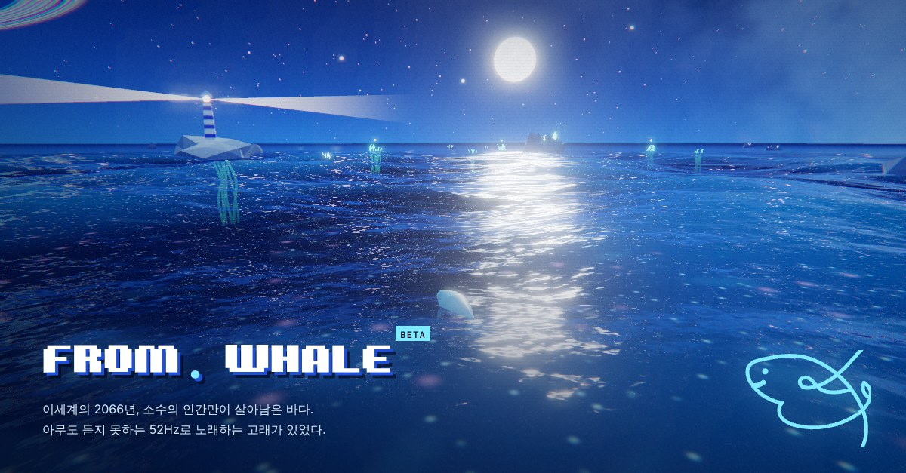
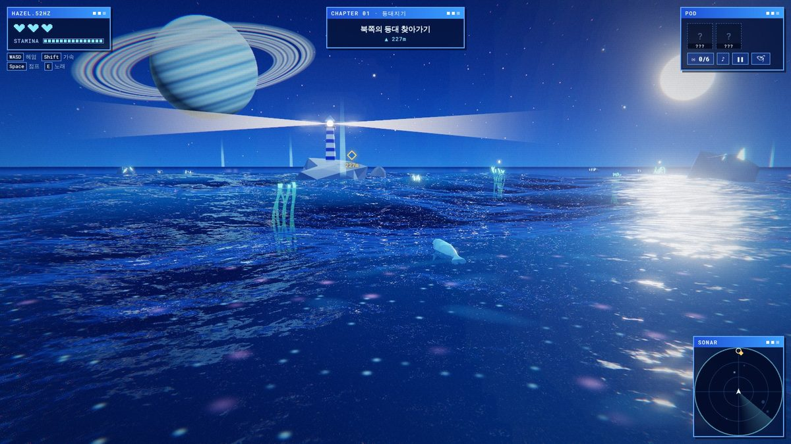
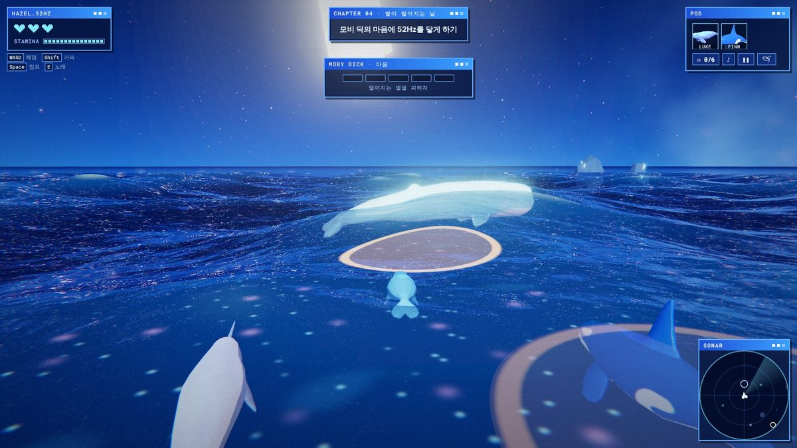
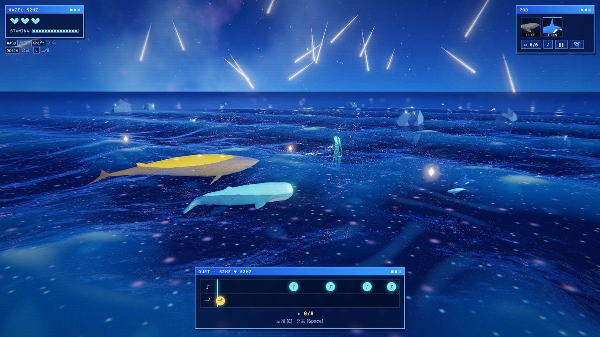
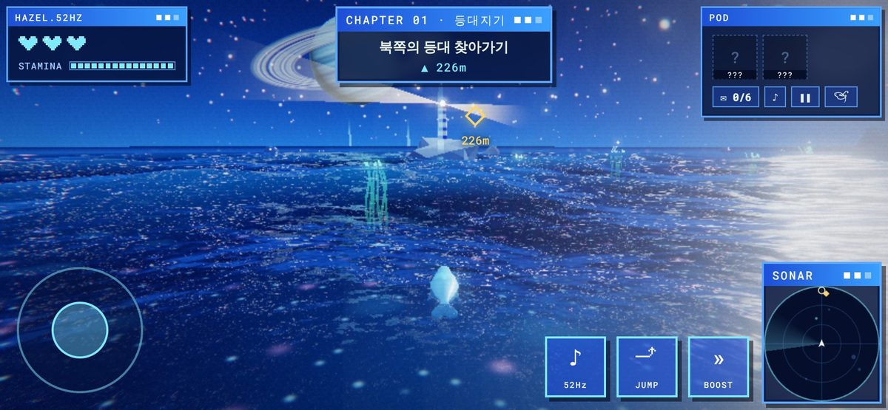

# 🐋 From. Whale

**English** · [한국어](README.ko.md)

**[▶ Play now](https://from-whale.netlify.app/game/)** · [Home page](https://from-whale.netlify.app/) · No install, runs in the browser (PC · phone)

A sea adventure of **Hazel**, a whale who sings at 52Hz. Another world, the year 2066, a night sea.

- MAP 1 · **The Night the Stars Fell** — the night sea: lighthouse, kelp, the Alliance, Moby Dick, Stella
- MAP 2 · **A Sea Born Without Waves** — down a trench to the base where the Alliance was made
- MAP 3 · **A Song That Calls the Dawn** — from night to dawn, the scattered voices of the Alliance

| Lighthouse and ringed planet | Moby Dick boss fight |
| --- | --- |
|  |  |
| **Duet with Stella · shooting stars** | **Phone, landscape** |
|  |  |

- Run locally: `python3 -m http.server` in the repo root → <http://localhost:8000/game/> (duet scoreboard shows this device only; `npx netlify dev` for the server too)
- Languages: 한국어 · English · 日本語 (picked from the device language)
- Custom nickname (default: 헤이즐 / Hazel / ヘイゼル)
- Saves: continue by chapter, seen endings kept separately
- LAB (phone pause menu): tilt steering, landscape only. Tip shown in the prologue
- Feedback: ending screen → Netlify Forms `feedback` (needs form detection and email notification)
- Link preview: `data/res/og.jpg` (1200×627, moonlit first scene). Refresh with LinkedIn Post Inspector after changing

### Features

- **No fighting** — no attacks, only a 52Hz song. Even the boss, Moby Dick, is won over by singing
- **52Hz as a game rule** — a song no one understands, letters translated by Luke
- **Call and response** — answer Finn's sobbing rhythm with a song (ch. 2)
- **Growing music** — synthesized live. Luke's bass, Finn's drums, dropped when a friend leaves. Saxophone in the epilogue
- **6 endings + ending gallery** — 4 decided by Luke's and Finn's fates + The Late Whale + A Whale's Stopped Heart (below). Unseen endings show hints only. All 6 unlock a **golden sea** (moon glitter fading from gold to sky blue, a golden moon, Hazel's glowing pattern sparkling brighter)
- **Kelp** — signposts with written directions, sing beside them to restore hearts
- **Moby Dick boss fight** — 6 songs that reach him win him over. Body hits and falling stars cost a heart; stun 1.1 s from stars, 1.5 s from charges (with Finn's Tears, a song clears it at once)
- **Stella (hidden ending)** — all 6 letters in bottles (Moby's prologue letter included) → 12-bar blues duet (PERFECT ±25 ms · EXCELLENT ±60 ms · GOOD ±150 ms, 450 max, S from 85% · A from 60%, a shooting star per jump note) → name the song and leave it with your nickname and score on the shared **Duet TOP 10**. After meeting Stella, "Sing the duet again" on the title or ending screen replays just the duet (save data untouched). Remaining letters can be found in the epilogue after the ending
- **Space and sea** — Gerstner waves, glittering ripples, ringed planet, shooting stars, bloom
- **MAP 2 · A Sea Born Without Waves** — a second map that opens after meeting Stella. Descend a trench and uncover the Alliance's secret (see MAP 2 below)
- **MAP 3 · A Song That Calls the Dawn** — back to the surface after the MAP 2 ending. Gather the Alliance's scattered voices into the Whale Symphony (see MAP 3 below)
- **Retro blue UI** — window-style HUD, sonar minimap (tap its title bar to fold it, remembered on the device), chapter cards, PC controls guide, current objective inside the HAZEL window (top center left clear). Portrait phones: one bottom row of joystick · sonar · 2×2 buttons (right thumb, screen center clear). One-line dialog at the bottom, two-column title, and the call-and-response window at the bottom left in tilt mode on landscape phones
- **Light models** — 500–650 vertices per whale, 512px textures. Phone support

### Branching endings

- Luke: hit by the Alliance at most once until reaching Moby Dick (Luke warns you after the first) → Luke lives, Luke's lantern (wider song range in the boss fight). Hit twice before the ch. 3 ambush → Luke's sacrifice at the ambush; the second hit after getting through it together → Luke rams in and falls on the spot. Either way, light shards (speed boost)
- Boss fight: Finn takes the first fall → broken compass (directions fade and go dark, restored by singing beside kelp) + Finn's Tears (sing while stunned → violet rain, stun cleared at once)
- All 6 letters before meeting Moby Dick: **The Late Whale** (regardless of Luke and Finn, Moby grumbles, Stella is late too) → Stella's duet follows, 2 endings in one run
- Two falls in one chapter: **A Whale's Stopped Heart** → Continue restarts that chapter (Finn's fall does not count)

| Ending | Luke | Finn |
| --- | --- | --- |
| The Light That Never Fades | ✕ | ○ |
| The Strength of Friends | ○ | ○ |
| The Broken Compass | ○ | ✕ |
| Sacrifice | ✕ | ✕ |
| The Late Whale | any | any |

- MAP 3 endings: **Everyone's Song** if you follow your friends' songs, not the drum, in the symphony (at most 2 taps on the drum), **A 52Hz Dawn** if the drum pulls you along. Whether you met Luke, Finn and Stella changes the symphony's lanes and lines

### MAP 2 · A Sea Born Without Waves

The name: the deep sea where no waves reach, and the Alliance (and Finn), born in tanks at the base, never knowing waves.

- Way in: after meeting Stella, "Into the deep" on the ending screen → a portal on the surface → dive. MAP 1 (lighthouse, kelp, Alliance…) is gone
- Progress: explore the five chambers (wreck, lab, terminal, whale bones, capsule) in any order. Only the base is held back by the current until all five are found. The sonar ◆ points at the nearest place not yet visited. Luke translates the writing, or only the drawings
- Finn's memories: each place found brings back one piece of Finn's past in the tank, always in order 1 → 5 (The Sea Behind the Glass, The Fishing Line, Crybaby No. 7, The Device on My Neck, Run), with the water briefly fading pale. Without Finn, recordings grad student J left for No. 7
- Space: at each log's depth the trench opens into a wide chamber, with narrow passages between. Each chamber has a beacon visible from afar (wreck warning light, lab windows, red terminal, altar, capsule, base searchlight)
- Walls: a colour per layer (sand and coral, teal, indigo, basalt with red veins), with the odd rock pillar
- Sights: a coral garden on the sunlight-zone walls, marine snow from the twilight down and a huge old ship resting on the wall, glowing plankton in Hazel's wake from the midnight zone (singing lights up all around), and in the trench glowing hydrothermal vents with rising hot water and tube worms
- Darkness: the moonlight fades with depth (wall outlines stay visible). Hazel's glowing pattern and her song (sonar) light the way. A rippling surface with a net of light overhead
- Story: at its heart, Finn and grad student J. The Alliance is a human AI experiment. The Shaman hears the base AI's orders as "the Voice of the Deep"; the whale bones are the altar of "purification"
- Alliance guards: black orcas with red eyes, patrolling the middle of the trench. Spotted → a one-second stare, then a chase; slip to the walls in time and they don't follow. The moray holes in the walls are taboo
- Objective marker: underwater it points at the log's real depth, with ▲ / ▼ and the height difference next to the distance
- Singing: nearby morays glow red (red dots on the sonar). Close guards freeze for 3.5 s at the "perfect song" learned from Stella; guards farther off hear it and come
- Moray eels: hide in the wall cracks, shiver, then lunge and bite (1 heart, short stun)
- Fishing: after picking up a line at the first log (the wrecked sub), press the song button by the floating buoy in each chamber (a green ring on the sonar). Hook it when the float dives, then reel in when the white line is in the green (three reds and the line snaps). With Luke it's his horn as a rod (generous), without him a clumsy fin; J's stone fishhook makes fish bite more easily. Each layer has its own catch, shown for a moment then let go. A sea life log of 21 kinds (saved on the device, FISH count on the MAP 2 ending)
- Hearts: refilled by reading a log; a jellyfish touch gives 1 (that jellyfish recharges for 30 s). Fainting wakes Hazel by the last log read (no heart-stop ending)
- Finale: an unexpected meeting outside the base (different if Finn survived) → the Shaman at the door → the stop code rhythm (light bubbles rise on each jump beat, a plankton ring on each song beat · Stella's voice + Finn's device, or the broken compass without Finn) → the red eyes go dark and the Shaman's Voice falls silent → MAP 2 ending "A Song Heard"

| Layer | Depth | Research log | Sea life · dangers |
| --- | --- | --- | --- |
| Sunlight | 0–40 m | Wrecked sub (30 m) | Reef fish schools (scatter when you come close) |
| Twilight | 40–120 m | Undersea lab (80 m) | Stingray, grouper, barracuda, reef sharks · guards, morays |
| Midnight | 120–250 m | Red terminal (150 m), whale bone altar (205 m) | Glowing moon jellyfish (brighter when you sing) · guards, morays |
| Trench | 250–318 m | Grad student J's last record (270 m), with a stone fishhook | Coelacanths · guards, morays |
| Base | 318 m– | The Doctor's memo (312 m) | Crabs, urchins, starfish, shrimp · the Shaman |

### MAP 3 · A Song That Calls the Dawn

Subtitle: Song of Liberation (working title). After the red eyes go dark, an Alliance that is free but has nowhere to go.

- Getting there: "Toward the dawn" on the MAP 2 ending screen → the surface. After seeing the MAP 2 ending, straight from "MAP 3 · Toward the dawn" on the title. Everything from MAPs 1 and 2 is gone
- Sky: a slow shift from night to dawn. Red spreads from the eastern horizon; stars, the Milky Way and the moon fade. Sea color, fog and light follow (brighter with each voice gathered)
- Prologue · the silent Alliance: the Alliance surfaces and won't move, even at the Shaman's command → three ways (whales who follow the Shaman · whales who want revenge · whales who refuse the war) → the Shaman's new order: the whole Alliance leaps together twice toward the coast, then marches toward the rising sun and the human coast
- The Frozen Lane: an ice field to the north. Ice floes block the way (shown on the sonar), a winding narrow channel, snow, thick fog
- Three scattered voices: each whale has its own task (after No.12, in any order). Once they come along, they follow in their own place beside Hazel

| Sea | Play | Whale |
| --- | --- | --- |
| The Frozen Lane (north) | A channel through the ice → sing beside three weak spots in the ice around the pool (glowing blue cracks) to break them → the ice splits and a way opens | No.12: trapped in a pool in the ice, circling, spouting now and then |
| The Sunken Fleet (west) | Sing beside three sunken ships → their windows light up with No.9's memories (the hands that changed the water · the day of the chip · the night the stars fell). Orange rings on the sonar | No.9: once set on revenge; after seeing every memory, chooses to come along |
| The Storm Sea (southeast) | Dark clouds · rain · lightning · high seas. Big waves spread from the center; jump just before each reaches you (or get swept back) → jump three big waves together with No.8 (it jumps when it sees you jump) → the storm settles | No.8: the youngest, seeing waves for the first time, curled up by the rocks |

- Dawn: brighter with each voice gathered. Card "VOICE n"
- The Forgotten Lighthouse (after the three seas): Luke's lighthouse, dark, at the end of the Frozen Lane
  - Three song stones (humpback · blue whale · sperm whale): sing beside one to wake the old whale song Luke carved with his horn. With Luke, he reads it; without him, only the carving
  - With all three awake, the lighthouse lights up → sing once, and Luke → Finn → the whales who came along answer in turn, each in its own voice, then all together
  - End: beyond the beam, the Shaman's pod marching on the coast → card "The Forgotten Lighthouse · The Language of the Sea"
- The coastal city and the march (far east, toward the sunrise)
  - The human coastal city: lit buildings, a sea wall, ships in the harbor, searchlights sweeping the sea. No swimming past the shoreline
  - The Shaman's march: the Alliance in three rows with the Shaman glowing red at the front. On every drumbeat they all surge forward; every sixteen beats they leap together. The drum grows louder as you approach
  - Drum rings: every four beats a red ring spreads from the Shaman. Sing the moment it reaches you to hold your ground (a golden ring), or get pushed back
  - The standoff: the Shaman's question "What were you made for!" → the Alliance's scattered answers → with Finn, No.7 says no by his own will for the first time; without him, No.7's story spreads through J's records → card "The Coastal City · Before the March"
- The Whale Symphony (the only rhythm game in MAP 3)
  - Moby Dick comes from behind ("I too once tried to cover the whole sea with my song alone"), and Stella too if you've met her
  - Lanes: the Shaman's drum on top · the voices you gathered (Luke → Finn → No.12 · No.9 · No.8 → Moby Dick → Stella) · Hazel at the bottom
  - A friend sings an off-beat phrase for one bar; answer in the same places the next bar. No notes shown ahead, only what was heard lingers briefly. Generous timing (±0.19 s); after two misses the other voice matches you first
  - Each voice you reach keeps repeating its phrase from the next bar → an ensemble that grows a lane at a time, and as many of the Alliance break free of the drum
  - The Shaman's drum keeps hitting every beat. Tapping on the drum grows the Shaman's chorus (red bar) and makes the Alliance flinch forward — not following orders is the answer
  - Last bar: everyone together; when Hazel sings, every voice answers in its own note. Hazel stays 52Hz to the end
- Dawn (cinematic)
  - The Shaman asks "Without orders, what are we supposed to live for?" → Hazel sings instead of answering → the Shaman's first sound of its own
  - Letterbox bars, HUD hidden; the sun rises from below the eastern horizon and the lighthouse goes dark
  - Everyone to their own sea: each whale leaving, with a caption (No.12 the northern sea · No.9 along the coast · No.8 the southern sea · Moby Dick the deep · Stella · the Shaman staying behind · Hazel and friends)
  - Closing poem: line by line, large in the middle of the screen over the sunrise
  - MAP 3 ending screen: this map's two endings, the voices that sang, times the drum pulled you along

### Characters

| Name | Role | Model |
| --- | --- | --- |
| Hazel | 52Hz finless porpoise, glowing pattern on the back | `data/hazel/Hazel.glb` |
| Luke | Narwhal lighthouse keeper, translator. In MAP 3, the conductor who wrote down the whales' songs | `data/luke/Luke.glb` |
| Finn | Crybaby orca guide | `data/finn/Finn.glb` |
| The Alliance | Orca pod; guards of the trench in MAP 2, scattered three ways in MAP 3 | `data/orca_army/Orca_Army.glb` |
| No.12 · No.9 · No.8 | Orcas from the same tank as Finn (MAP 3): the Frozen Lane · the Sunken Fleet · the Storm Sea | `Orca_Army.glb` + `recolor` (No.8 smaller) |
| Alliance chief · Shaman | Pink orca; hears the base AI as "the Voice of the Deep" (MAP 2) | `Orca_Army.glb` + `recolor` |
| Moby Dick | Sperm whale, final boss | `data/moby/Moby.glb` |
| Stella | Yellow blue whale, another 52Hz, throat pleats, sparkling six-point star on the back | `data/stella/Stella.glb` (generated by `tools/make_stella.py`) |
| MAP 2 sea life | Reef fish, jellyfish, coelacanth, crabs and more (24 kinds), moray eels as the threat | `data/polyfork/*.glb` ([Polyfork](https://polyfork.dev) free low-poly, Meshopt compressed, loaded when the portal opens) |

Color options (`Whale` in `game/js/actors.js`): `solidColor` for a single color, `recolor: [ dark, light ]` to recolor while keeping the pattern

### Controls

| Keyboard | Mobile | Action |
| --- | --- | --- |
| `W A S D` / arrow keys | Joystick | Swim (camera-relative: S or pulling the joystick down turns Hazel toward the screen so you see her face · A·D strafe) |
| Mouse drag | Screen drag | Camera (on phones it returns behind the whale after a moment) |
| — | Tilt (LAB, landscape) | Lean forward to swim, back to reverse, sideways to turn |
| `Shift` | `»` | Boost (stamina) |
| `Space` | `⤴` (UP under the sea) | Jump (invincible in the air) · ambush dodge · duet jump notes · swim up under the sea |
| `C` | `⤵` (under the sea only) | Swim down under the sea |
| `E` | `♪` | Sing · talk · sonar · next line · call and response · duet song notes · fishing (MAP 2) · breaking ice · holding against the drum · answering in the symphony (MAP 3) |
| `L` / `M` / `Esc` | Top-right buttons | Letters / sound / pause |
| Whale chip in the POD window | Whale chip in the POD window | Home page |

### Home page

- PLAY · ABOUT (PITCH / CONCEPT / BGM) · CONTACT (email · GitHub repo · LinkedIn)
- `#pitch`, `#concept`, `#bgm` open a tab directly
- Font: Squaredance (`files/SquaredanceFontV1-Regular.ttf`)

### Files

| File | Contents |
| --- | --- |
| `index.html`, `landing.css`, `landing.js` | Home page |
| `game/index.html`, `game/style.css` | Game screen, HUD |
| `game/js/ocean.js` | Gerstner waves (GPU + matching CPU version) |
| `game/js/sky.js` | Night sky, ringed planet, shooting stars, reflection cubemap, dawn · storm sky (MAP 3) |
| `game/js/world.js` | Seabed, rocks, lighthouse, kelp, bottles, light shards |
| `game/js/actors.js` | Whale models, swim shader, recoloring, portraits |
| `game/js/audio.js` | Synthesized music, sound effects |
| `game/js/ui.js` | HUD, dialog box, chapter cards, sonar |
| `game/js/story.js` | Chapter flow, branching endings, map coordinates, MAP 2 story · stop code, MAP 3 story · each whale's song (No.12 · No.9 · No.8) |
| `game/js/lang/*.js` | Text per language (ko / en / ja) |
| `game/js/i18n.js` | Language selection |
| `game/js/name.js` | Nickname, Korean particles (`{N은}`, `{N을}`) |
| `game/js/dive.js` | MAP 2: portal, underwater view (water ceiling, particles, light shafts, depth layers, sonar) |
| `game/js/fishing.js` | MAP 2 fishing: float, hook, reel, catch per layer, sea life log |
| `game/js/guards.js` | MAP 2 Alliance guards: patrol, chase, hearing the song, wall taboo, bone altar ritual |
| `game/js/sealife.js` | MAP 2 sea life: where each kind lives, schools, drifting jellyfish, bottom crawlers, moray eel ambushes |
| `game/js/map2.js` | MAP 2: trench terrain, landmarks per layer (sub · lab · terminal · whale bones · base), research log positions |
| `game/js/map3.js` | MAP 3: dawn sea colors, ice field · channel, snow, the Sunken Fleet, the storm (rain · lightning · big waves), song stones, the coastal city, the Shaman's march · drum, the silent Alliance, the whales you meet |
| `game/js/symphony.js` | MAP 3 Whale Symphony: the Shaman's drum · answering friends' off-beat phrases · lanes that build up · a Shaman's chorus that grows when you follow the drum |
| `game/js/voices.js` | MAP 3 whale voices (orca whistles, Luke's horn, Moby Dick, Stella, Hazel), the old whale songs |
| `game/js/scores.js` | Duet scoreboard window (saves on this device only when the server can't be reached) |
| `game/js/main.js` | Rendering, bloom, input, Alliance AI, boss fight, routes · ending gallery, epilogue |
| `netlify/functions/duet-scores.mjs` | Duet scoreboard server (Netlify Functions + Blobs). Keeps the TOP 50; checks length, banned words, score matching the judgment counts, 20 s between posts. Remove entries in the Netlify dashboard → Blobs → `duet-scores` → `top-v2` |
| `package.json` | `@netlify/blobs` for the server code |
| `tools/make_stella.py` | Stella model generator (low-poly blue whale with texture). Edit the numbers, then `python3 tools/make_stella.py` |
| `scene.html` | Early 3D whale scene |

### Dev URL options

- `?chapter=0~6` start at a chapter (0 prologue … 5 ending, 6 epilogue)
- `?stella` start at the ending with all 6 letters (Stella → duet → sub ending). Save data untouched
- `?route=light|friends|compass|sacrifice|late` start ch. 4 onward on that route (with `?chapter=4` or `?chapter=5`, e.g. `?chapter=5&route=compass`)
- `?duet` just the duet, once you've met Stella (same as the title / ending screen button; scores go to the scoreboard; save data untouched)
- `?dive` start at MAP 2 (portal → under the sea). Save data untouched
- `?dawn` start at MAP 3 (the surface before dawn). Save data untouched
- `?gold` preview the all-endings reward (golden sea). Save data untouched
- `?q=low` low-spec mode (automatic on touch devices)
